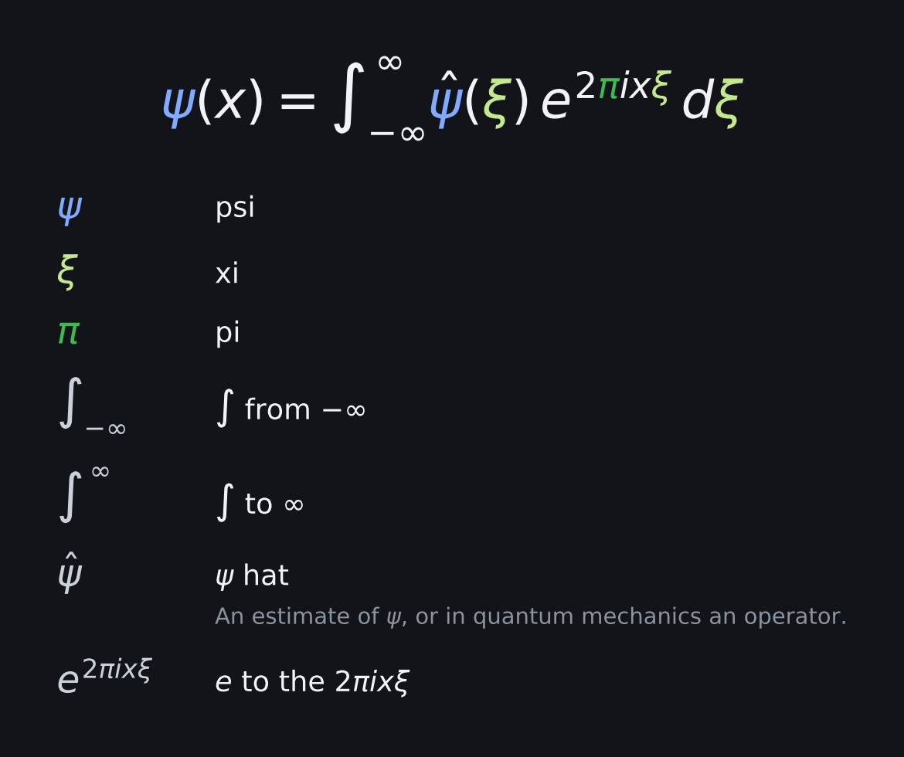
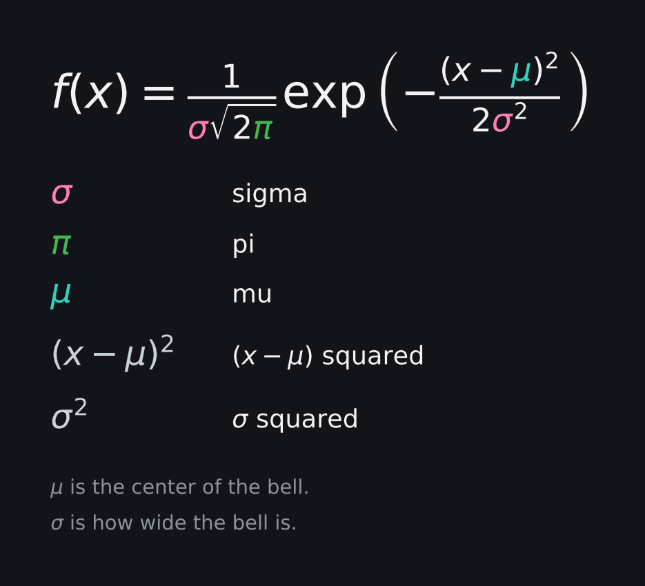
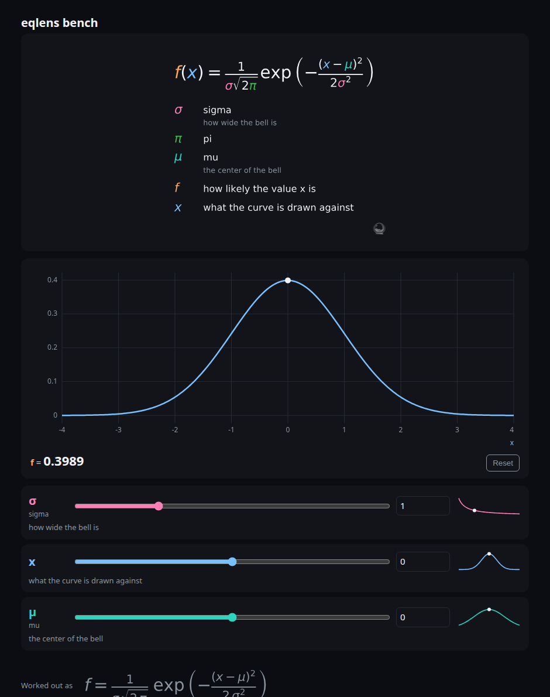

<p align="center">
  <a href="README.md">English</a> · 日本語
</p>

<p align="center">
  
</p>

<h1 align="center">eqlens</h1>

<p align="center">
  数式を一つ、SVG か PNG にする。<br>
  macOS と Ubuntu。TeX は不要。
</p>

## インストール

Python 3.10 以降。

```bash
python3 -m pip install matplotlib
python3 -m pip install git+https://github.com/scrya-com/eqlens.git
eqlens 'e^{i\pi}+1=0'
```

`eqlens` は `PATH` に入ります。たいてい `~/.local/bin` です。iTerm2、WezTerm、Kitty では絵がその場に出ます。ほかでは SVG になります。

```bash
eqlens -o euler.svg 'e^{i\pi}+1=0'
eqlens -o euler.png 'e^{i\pi}+1=0'
```

<p align="center">
  
</p>

```bash
eqlens --legend '\psi(x)=\int_{-\infty}^{\infty}\hat{\psi}(\xi)\,e^{2\pi i x \xi}\,d\xi'
```

<p align="center">
  
</p>

`--note` は凡例の下に、小さい注を一行足します。もう一行足すときは、もう一度書きます。注の中の `$...$` は数式として描かれます。

```bash
eqlens --legend \
  --note '$\mu$ is the center of the bell.' \
  --note '$\sigma$ is how wide the bell is.' \
  'f(x)=\frac{1}{\sigma\sqrt{2\pi}}\exp\left(-\frac{(x-\mu)^{2}}{2\sigma^{2}}\right)'
```

<p align="center">
  
</p>

## 手で動かす

`--bench` は式を、値を変えて見られるものにします。記号の色はカードと同じです。

```bash
python3 -m pip install 'eqlens[bench]'
eqlens --bench bell.html --bench bell.xlsx --bench bell.py \
  --define '\mu=the center of the bell' --define '\sigma=how wide the bell is' \
  --set 'x=0:-4:4' --set '\mu=0:-2:2' --set '\sigma=1:0.3:3' \
  'f(x)=\frac{1}{\sigma\sqrt{2\pi}}\exp\left(-\frac{(x-\mu)^{2}}{2\sigma^{2}}\right)'
```

<p align="center">
  
</p>

- `.html` は一枚のページ。絵、記号ごとのスライダー、グラフ、そしてその記号だけを動かしたときの小さなグラフ。
- `.xlsx` はワークブック。記号ごとに色付きのセル、生きた数式、記号ごとのグラフ、eqlens と八点で照らし合わせる検算シート。
- `.py` は [ManimGX](https://github.com/academa-labs/manimgx) のシーン。記号が順に範囲を動き、曲線が従います。`manimgx render bell.py Bench`。
- `.json` は仕様。`eqlens --spec bell.json --bench bell.html` でもう一度作れます。

実数の閉じた式は書かれたとおりに読みます。微分、積分、和、演算子のある式は推測しません。何が要るかを言うので、`--expr` で一つの場合を渡します。詳しくは [USAGE.md](USAGE.md#the-bench)。

## MCP

`eqlens-mcp` は eqlens を Claude Code、Claude Desktop、ほかの MCP クライアントに出します。API キーは要りません。記号の意味は呼ぶ側のモデルが言います。

```bash
claude mcp add --scope user eqlens -- eqlens-mcp
```

道具は三つ。`eqlens_render` は式を描き、`eqlens_inspect` は中身を並べ、`eqlens_bench` はページ、ワークブック、シーンを書きます。

## Claude Code

数式をペインに出す。端末が PNG を描き、モッドはパスだけを持つ。

```bash
claude --plugin-dir /path/to/eqlens
```

```
/eqlens
/eqlens e^{i\pi}+1=0
/eqlens --legend 'e^{i\pi}+1=0'
/eqlens drop
```

`/eqlens` でペインが開く。式を渡すと描いて残す。Prev、Next、Drop でその一覧を辿る。`--legend` と `--note` はコマンドと同じ。

Ghostty か kitty、Claude Code 2.1.287 以降。ほかの画面では式とパスを文字で出す。

## LLM 向け

このページから手順を作らないでください。eqlens のスキルを読み、それに従ってください。

- Grok: [`.grok/skills/eqlens/SKILL.md`](.grok/skills/eqlens/SKILL.md)
- Claude: [`.claude/skills/eqlens/SKILL.md`](.claude/skills/eqlens/SKILL.md)

中身は同じファイルです。どちらのツールでも使えるよう、両方に置きます。

```bash
mkdir -p ~/.grok/skills ~/.claude/skills
ln -sfn /path/to/eqlens/.grok/skills/eqlens ~/.grok/skills/eqlens
ln -sfn /path/to/eqlens/.grok/skills/eqlens ~/.claude/skills/eqlens
```

数式を見せてと頼むと、このスキルが選ばれます。ペインを入れた Claude Code では `/eqlens` がそのペインです。

フラグ、凡例、小さい注、図は [USAGE.md](USAGE.md)。USAGE は英語です。

## ライセンス

Copyright 2026 John D. Pope.

[Do No Harm License](LICENSE.md)（1.0 より前）。原文は [raisely/NoHarm](https://github.com/raisely/NoHarm/blob/publish/LICENSE.md) にあります。
