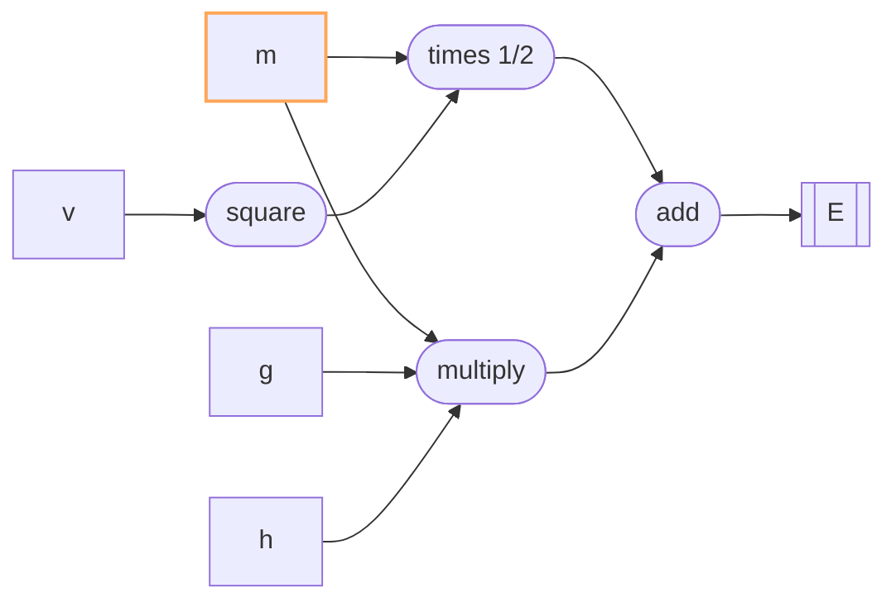

<p align="center">
  <a href="README.md">English</a> · 日本語
</p>

<p align="center">
  
</p>

<h1 align="center">eqlens</h1>

<p align="center">
  数式を一つ、SVG か PNG にします。<br>
  記号ごとに色が付き、読み方が添えられ、指すとその意味が光ります。<br>
  ウェブページでは記号の下にカードが開き、その記号だけが結果をどう変えるかを動くグラフで見せます。<br>
  手で動かすベンチも作ります。スライダーのページ、ワークブック、アニメーションが同じ色で揃います。<br>
  式を読み上げ、シェーダーで描き、MCP でエージェントに使わせます。<br>
  画像を出せない端末では点字の点で描き、その点をソースファイルにコメントとして書き込みます。<br>
  流れを見る価値のある式には、同じ色の Mermaid 図も出します。<br>
  macOS と Ubuntu。TeX は不要です。
</p>

<p align="center">
  <a href="https://scrya.com/eqlens">ブラウザで試す: scrya.com/eqlens</a>
</p>

## インストール

Python 3.10 以降。

```bash
python3 -m pip install matplotlib
python3 -m pip install git+https://github.com/scrya-com/eqlens.git
eqlens 'e^{i\pi}+1=0'
```

`eqlens` は `PATH` に入ります。たいてい `~/.local/bin` です。iTerm2、WezTerm、Kitty では絵がその場に出ます。ほかでは SVG になります。

```bash
eqlens -o euler.svg 'e^{i\pi}+1=0'
eqlens -o euler.png 'e^{i\pi}+1=0'
```

<p align="center">
  
</p>

## 記号に名前を付ける

`--legend` はギリシャ文字に色を付け、式の下に英語の名前と並べます。アクセントや添字は人が言うとおりに読みます。「ψ hat」「∫ from −∞」「u star」「A transpose」。べき乗でない印は、そうでないと書きます。

```bash
eqlens --legend '\psi(x)=\int_{-\infty}^{\infty}\hat{\psi}(\xi)\,e^{2\pi i x \xi}\,d\xi'
```

<p align="center">
  
</p>

## 意味を書く

`--define` は、この式での記号の意味を与えます。記号に色と行が付きます。

```bash
eqlens --legend \
  --define 'P=keeps the part of the noise the cell can see' \
  --define 'A_e=squeezes a cell of fine tokens into one' \
  --define 'u^\star=the target the model is trained on' \
  'u^\star=P\,\epsilon-x_0,\qquad P=A_eA_e^\top'
```

<p align="center">
  
</p>

`--note` は凡例の下に、小さい注を一行足します。もう一行足すときは、もう一度書きます。注の中の `$...$` は数式として描かれます。

```bash
eqlens --legend \
  --note '$\mu$ is the center of the bell.' \
  --note '$\sigma$ is how wide the bell is.' \
  'f(x)=\frac{1}{\sigma\sqrt{2\pi}}\exp\left(-\frac{(x-\mu)^{2}}{2\sigma^{2}}\right)'
```

<p align="center">
  
</p>

## 記号を開く

`--tier` は記号が何でできているかを書きます。その式が記号の行の下に描かれ、中の記号をさらに開けます。

```bash
eqlens --brief \
  --define 'P=keeps the coarse part' \
  --tier 'P=A_eA_e^\top' --tier 'A_e=VU^\top' \
  -o recover.html 'v=P\,u_a+\frac{(I-P)\,(x_t+u_a)}{\sigma}'
```

<p align="center">
  
</p>

`.html` の出力はウェブページに置く断片で、ボタンが三つ付きます。**Read** は式全体を言葉にして絵の横に開き、スピーカーで聞けます。**Expand** は階層を開きます。**Copy** は TeX をクリップボードに入れます。`eqlens --read` は同じ言葉を出力します。断片の中で記号を指すと、下にカードが開きます。記号の意味と、式が計算できるときは、その記号だけを動かしたときの結果の小さな動くグラフです。どの式でも働き、手で描いたものはありません。

## シェーダーで描く

出力の名前を `.glsl` か `.frag` にするか、`--format glsl` を渡すと、式を凡例ごと描く WebGL2 のフラグメントシェーダーになります。どの大きさでも鮮明です。記号を指す（`iMouse`）と SVG と同じように光り、中の `mainImage` はそのまま Shadertoy に貼れます。

```bash
eqlens --legend -o euler.frag 'e^{i\pi}+1=0'
```

[動いているところ](https://claude.ai/artifact/Q6151o5gGRHZBegqGHh2sV)。TokenStream 論文の式を、それぞれのシェーダーが描いています。動かし方は [USAGE.md](USAGE.md#shader-glsl-for-webgl2-and-shadertoy) にあります。

## 手で動かす

`--bench` は式を、値を変えて見られるものにします。記号の色はカードと同じです。

```bash
python3 -m pip install 'eqlens[bench]'
eqlens --bench bell.html --bench bell.xlsx --bench bell.py \
  --define '\mu=the center of the bell' --define '\sigma=how wide the bell is' \
  --set 'x=0:-4:4' --set '\mu=0:-2:2' --set '\sigma=1:0.3:3' \
  'f(x)=\frac{1}{\sigma\sqrt{2\pi}}\exp\left(-\frac{(x-\mu)^{2}}{2\sigma^{2}}\right)'
```

<p align="center">
  
</p>

- `.html` は一枚のページ。絵、記号ごとのスライダー、グラフ、そしてその記号だけを動かしたときの小さなグラフ。記号を指すと、そのスライダーが光ります。
- `.xlsx` はワークブック。記号ごとに色付きのセル、生きた数式、記号ごとのグラフ、eqlens と八点で照らし合わせる検算シート。
- `.py` は [ManimGX](https://github.com/academa-labs/manimgx) のシーン。記号が順に範囲を動き、曲線が従います。`manimgx render bell.py Bench`。
- `.json` は仕様。`eqlens --spec bell.json --bench bell.html` でもう一度作れます。

実数の閉じた式は書かれたとおりに読みます。微分、積分、和、演算子のある式は推測しません。何が要るかを言うので、`--expr` で一つの場合を渡します。詳しくは [USAGE.md](USAGE.md#the-bench)。

## 端末で見る、ソースに書き込む

GNOME Terminal のように画像を出せない端末では、式を点字の点で描きます。記号は色を保ち、凡例は言葉でその下に並びます。`--display text` はどの端末でも点だけを出します。

```bash
eqlens --display text --legend 'e^{i\pi}+1=0'
```

`--burn` は同じ点を、そのファイルの言語のコメントとしてソースファイルの先頭に書き込みます。点の下に凡例、注、TeX が入るので、式を検索できます。同じ式をもう一度書き込むと、二つにならず、置き換わります。`--comment py` はそのブロックを出力するだけです。

```bash
eqlens --burn triangle.py 'a^2+b^2=c^2'
```

```python
# ── eqlens ──────────────────────────────────────
#        ⠋⢙⡆           ⢠    ⠋⠙⡆               ⠊⠙⡆
#   ⠠⠤⢤⡄ ⣠⣊⡀     ⡇     ⣿⠤⢤⡄ ⣠⣊⡀  ⢀⣀⣀⣀⣀⡀   ⣠⠤⠤ ⣠⣞⡁
#  ⢀⡴⠒⢲⡇ ⠉⠉⠁  ⠐⠒⠺⡗⠒⠂  ⢰⡏ ⢠⡇ ⠉⠉⠁  ⢀⣭⣭⣭⣭⡅  ⢸⠃   ⠈⠉⠁
#  ⠈⠳⠖⠻⠃         ⠇    ⠸⠳⠶⠛               ⠘⠳⠶⠂
#
#    a^2+b^2=c^2
# ────────────────────────────────────────────────
```

## 式の流れを図にする

`--diagram` は式を [Mermaid](https://mermaid.js.org) のフローチャートにします。何が入り、何をして、何が出るか。記号の箱は絵と同じ色なので、ページに並べると目で対応が取れます。二度使う記号も箱は一つです。

```bash
eqlens --diagram plain --define 'm=the mass' 'E = \frac{1}{2} m v^2 + m g h'
```



`dark` は eqlens の地の色、`light` は白いページ、`plain` はテーマなしで、README のようにページ側が色を決める場所に使います。計算できる式は手順として、`L' = \mathrm{Conv}_\theta(L_0, L_1, C_0)` のように何をするかを名指す式は呼び出しとして描きます。

図が何も足さないときは、そう言います。`F = ma` は一手だけです。積分や和のある式は推測せず、図を出しません。eqlens は Mermaid を動かしません。描くのは GitHub、Claude のアーティファクト、または Mermaid を読み込んだページです。詳しくは [USAGE.md](USAGE.md#a-diagram-of-the-formula)。

## MCP

`eqlens-mcp` は eqlens を Claude Code、Claude Desktop、ほかの MCP クライアントに出します。API キーは要りません。記号の意味は呼ぶ側のモデルが言います。

```bash
claude mcp add --scope user eqlens -- eqlens-mcp
```

道具は五つ。`eqlens_render` は式を描き、`eqlens_comment` は式をソースファイルにコメントとして書き込み、`eqlens_diagram` は式の流れを Mermaid 図で返し、`eqlens_inspect` は中身を並べ、`eqlens_bench` はページ、ワークブック、シーンを書きます。入れたら「理想気体の法則のベンチを作って」と頼んでみてください。

## Claude に言わせる

`--introspect` は式の各部分が何を表すかを Claude に尋ね、それを描きます。`pip install 'eqlens[ai]'` と `ANTHROPIC_API_KEY` が要ります。

```bash
eqlens --introspect -o einstein.svg 'G_{\mu\nu}+\Lambda g_{\mu\nu}=\frac{8\pi G}{c^4}T_{\mu\nu}'
```

`--inspect` を足すと意味が JSON で出るので、取っておけばキーなしで描き直せます。詳しくは [USAGE.md](USAGE.md#let-claude-say-what-the-parts-mean)。

## 指してみる

SVG をウェブページにインラインで置くか、ファイルをブラウザで開きます。記号を指すと、それが現れる場所すべてと凡例の行が光り、ほかは暗くなります。SVG の中の CSS だけで、スクリプトはありません。

[scrya.com/eqlens](https://scrya.com/eqlens) に試せる式が十二あります。自分のページに置く方法は [USAGE.md](USAGE.md#hover) にあります。

## 描けるもの

一度に式を一つ。組むのは matplotlib の mathtext です。分数、根号、積分、和、アクセント、下付き、上付き、`\mathrm`、`\mathbb`、`\mathcal`、ギリシャ文字。`\begin{...}` の環境とプリアンブルは使えません。

テストは物理、量子物理、機械学習の式を五十ほど描き、凡例のどの記号も式の中に見つかることを確かめます。[`tests/equations.py`](tests/equations.py)。

## Claude Code

チャットの横に、式のためのペインを出します。Claude Code を [Kitty](https://sw.kovidgoyal.net/kitty/) で動かすと、ペインに本物の絵が出ます。`/eqlens` が式をそこに描き、エージェントが描いた式もそこに入ります。


```bash
sudo apt install kitty        # または: brew install --cask kitty
kitty claude --plugin-dir /path/to/eqlens
```

```
/plugin install eqlens --marketplace scrya-com/eqlens
```

チェックアウトから一回だけ読み込むこともできます。

```bash
claude --plugin-dir /path/to/eqlens
```

eqlens の MCP サーバーもつないであると、ペインはそれに従います。`eqlens_render` が描いた PNG がペインにも出ます。

```
/eqlens
/eqlens e^{i\pi}+1=0
/eqlens --legend 'e^{i\pi}+1=0'
/eqlens drop
```

`/eqlens` でペインが開きます。式を渡すと描いて残します。Prev、Next、Drop でその一覧を辿ります。`--legend`、`--define`、`--note` はコマンドと同じです。

PNG を描けるのは Kitty、Ghostty、iTerm2 で、Claude Code 2.1.287 以降が要ります。GNOME Terminal などほかの端末では、式を点字の点で描き、凡例を言葉でその下に出します。窓が狭いと、`/eqlens` と打つまでペインは開きません。

## LLM 向け

このページから手順を作らないでください。eqlens のスキルを読み、それに従ってください。

- Grok: [`.grok/skills/eqlens/SKILL.md`](.grok/skills/eqlens/SKILL.md)
- Claude: [`.claude/skills/eqlens/SKILL.md`](.claude/skills/eqlens/SKILL.md)

中身は同じファイルです。どちらのツールでも使えるよう、両方に置きます。

```bash
mkdir -p ~/.grok/skills ~/.claude/skills
ln -sfn /path/to/eqlens/.grok/skills/eqlens ~/.grok/skills/eqlens
ln -sfn /path/to/eqlens/.grok/skills/eqlens ~/.claude/skills/eqlens
```

数式を見せてと頼むと、このスキルが選ばれます。ペインを入れた Claude Code では `/eqlens` がそのペインに描きます。

フラグ、フォント、ホバー、サーバー、Python からの呼び出しは [USAGE.md](USAGE.md)。USAGE は英語です。

## 以前は mathcat でした

eqlens は 0.2 より前は `johndpope/mathcat` でした。古いアドレスはここへ転送され、`mathcat` コマンドも今までどおり動きます。

## ライセンス

Copyright 2026 John D. Pope.

[Do No Harm License](LICENSE.md)（1.0 より前）。原文は [raisely/NoHarm](https://github.com/raisely/NoHarm/blob/publish/LICENSE.md) にあります。
