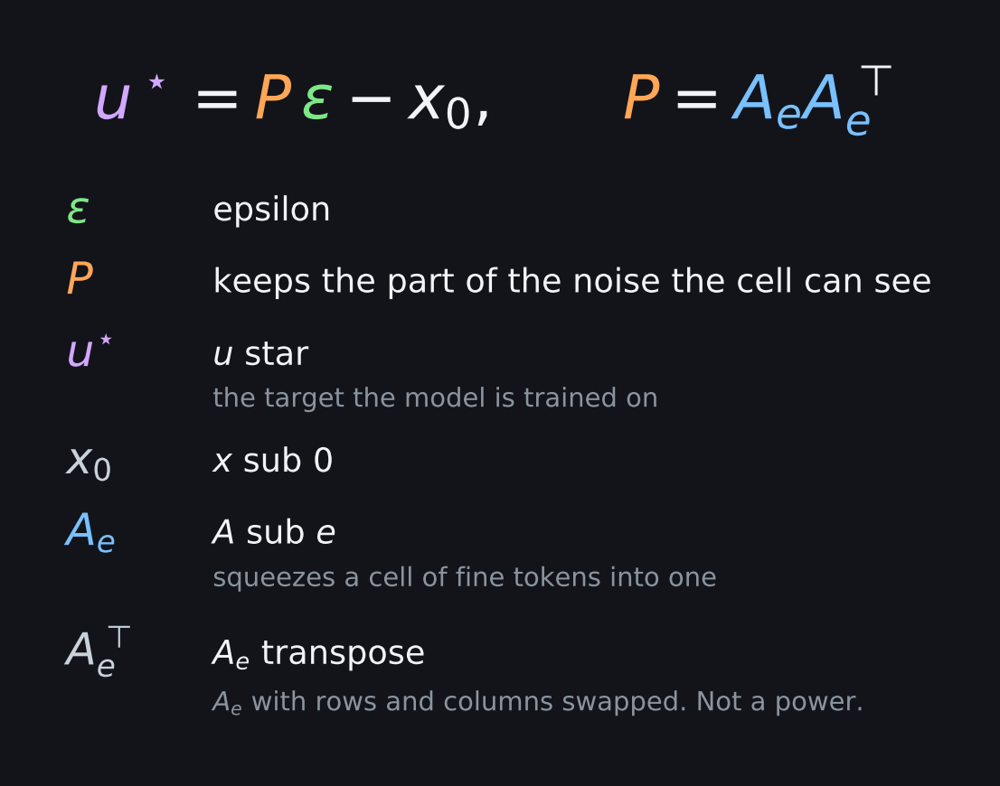
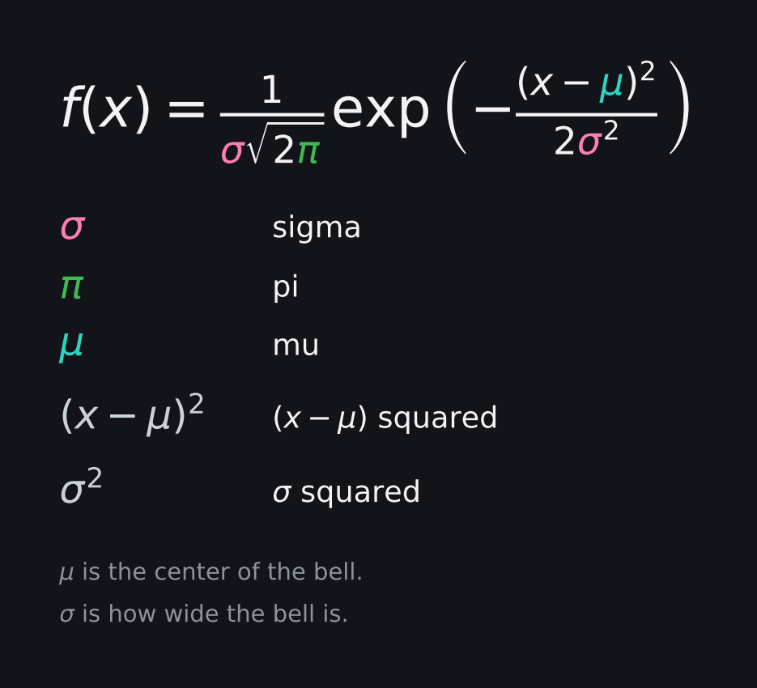
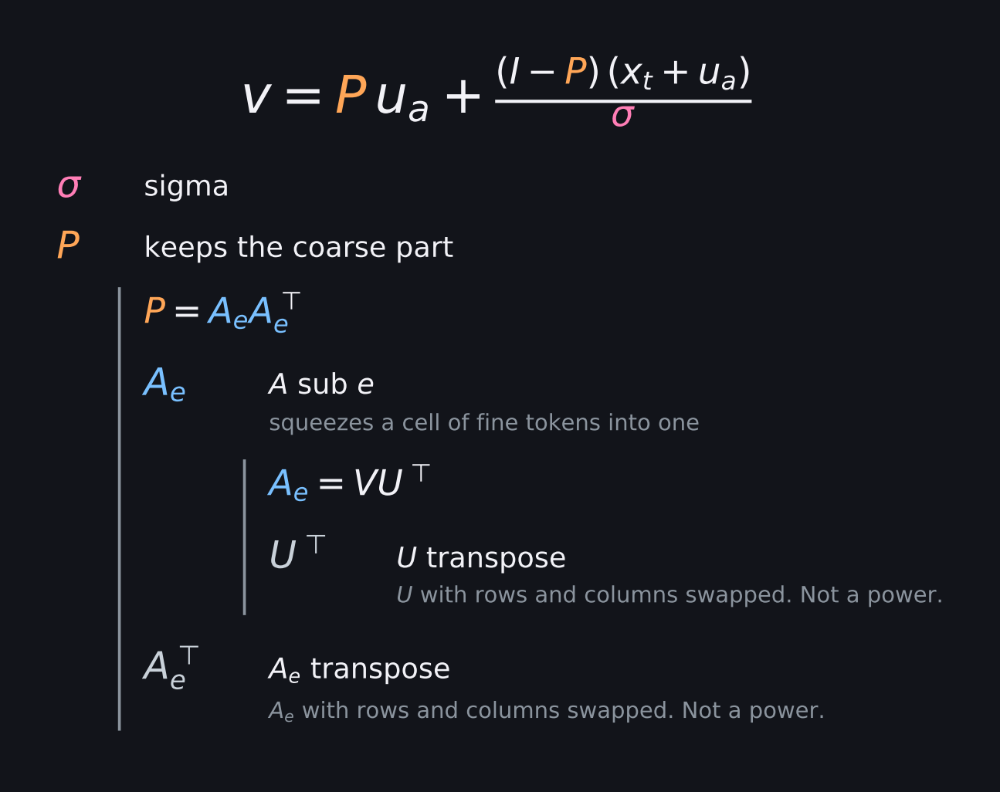

<p align="center">
  English · <a href="README.ja.md">日本語</a>
</p>

<p align="center">
  
</p>

<h1 align="center">eqlens</h1>

<p align="center">
  One math formula, drawn as an SVG or a PNG.<br>
  Every symbol colored, named the way you say it, and lit up with its meaning when you point at it.<br>
  macOS and Ubuntu. No TeX install.
</p>

<p align="center">
  <a href="https://scrya.com/eqlens">Try it in a browser: scrya.com/eqlens</a>
</p>

## Install

Python 3.10 or newer.

```bash
python3 -m pip install matplotlib
python3 -m pip install git+https://github.com/scrya-com/eqlens.git
eqlens 'e^{i\pi}+1=0'
```

`eqlens` lands on your `PATH`, usually at `~/.local/bin`. iTerm2, WezTerm, and Kitty show the picture inline. Anywhere else you get an SVG:

```bash
eqlens -o euler.svg 'e^{i\pi}+1=0'
eqlens -o euler.png 'e^{i\pi}+1=0'
```

<p align="center">
  
</p>

## Name the symbols

`--legend` colors each Greek letter and lists it under the formula with its English name. Accents and scripts are read the way people say them: "ψ hat", "∫ from −∞", "u star", "A transpose". A mark that is not a power says so.

```bash
eqlens --legend '\psi(x)=\int_{-\infty}^{\infty}\hat{\psi}(\xi)\,e^{2\pi i x \xi}\,d\xi'
```

<p align="center">
  
</p>

## Say what they mean

`--define` gives a symbol its meaning in this formula. It gets a color and a row.

```bash
eqlens --legend \
  --define 'P=keeps the part of the noise the cell can see' \
  --define 'A_e=squeezes a cell of fine tokens into one' \
  --define 'u^\star=the target the model is trained on' \
  'u^\star=P\,\epsilon-x_0,\qquad P=A_eA_e^\top'
```

<p align="center">
  
</p>

`--note` adds a short line in fine print under the ledger. Repeat it for another line. `$...$` inside a note draws as math.

```bash
eqlens --legend \
  --note '$\mu$ is the center of the bell.' \
  --note '$\sigma$ is how wide the bell is.' \
  'f(x)=\frac{1}{\sigma\sqrt{2\pi}}\exp\left(-\frac{(x-\mu)^{2}}{2\sigma^{2}}\right)'
```

<p align="center">
  
</p>

## Open a symbol up

`--tier` says what a symbol is made of. Its formula is drawn under its row, and a symbol in there can open again.

```bash
eqlens --brief \
  --define 'P=keeps the coarse part' \
  --tier 'P=A_eA_e^\top' --tier 'A_e=VU^\top' \
  -o recover.html 'v=P\,u_a+\frac{(I-P)\,(x_t+u_a)}{\sigma}'
```

<p align="center">
  
</p>

An `.html` output is a fragment for a web page with three glyph buttons: **Read** opens the whole formula in words beside the drawing, with a speaker to hear it; **Expand** opens the tiers; and **Copy** puts the TeX on the clipboard. `eqlens --read` prints the same words.

## Or draw it with a shader

Name the output `.glsl` or `.frag`, or pass `--format glsl`, for a WebGL2 fragment shader that draws the formula, ledger and all, sharp at any size. Pointing at a symbol (`iMouse`) lights it as in the SVG, and the `mainImage` inside pastes straight into Shadertoy.

```bash
eqlens --legend -o euler.frag 'e^{i\pi}+1=0'
```

[See it running](https://claude.ai/artifact/Q6151o5gGRHZBegqGHh2sV): the equations of the TokenStream paper, each drawn by its own shader. [USAGE.md](USAGE.md#shader-glsl-for-webgl2-and-shadertoy) says how to run it.

## Or let Claude say it

`--introspect` asks Claude what the parts of the formula stand for and draws them for you. It needs `pip install 'eqlens[ai]'` and an `ANTHROPIC_API_KEY`.

```bash
eqlens --introspect -o einstein.svg 'G_{\mu\nu}+\Lambda g_{\mu\nu}=\frac{8\pi G}{c^4}T_{\mu\nu}'
```

Add `--inspect` to get the meanings as JSON, so you can keep them and draw again without a key. [USAGE.md](USAGE.md#let-claude-say-what-the-parts-mean) has the rest.

## Point at it

Put the SVG inline in a web page, or open the file in a browser. Point at a symbol: every place it appears lights up with its row, and the rest dims. It is CSS inside the SVG, with no script.

There are twelve formulas to try at [scrya.com/eqlens](https://scrya.com/eqlens). [USAGE.md](USAGE.md#hover) shows how to put one in your own page.

## What it draws

One formula per call, set by matplotlib's mathtext: fractions, roots, integrals, sums, accents, subscripts, superscripts, `\mathrm`, `\mathbb`, `\mathcal`, and Greek. No `\begin{...}` environments and no preamble.

The tests draw some fifty formulas from physics, quantum physics, and machine learning, and check that every symbol in a ledger is found again in its formula: [`tests/equations.py`](tests/equations.py).

## Claude Code

A pane for the formulas. The terminal paints the PNG. The mod keeps the path.

```bash
claude --plugin-dir /path/to/eqlens
```

```
/eqlens
/eqlens e^{i\pi}+1=0
/eqlens --legend 'e^{i\pi}+1=0'
/eqlens drop
```

`/eqlens` opens the pane. A formula is drawn and kept. Prev, Next, and Drop walk that list. `--legend`, `--define`, and `--note` are the same flags as the command line.

Ghostty or kitty, and Claude Code 2.1.287 or later. On another surface the pane shows the formula and the path.

## For an LLM

Do not invent a workflow from this page. Load the eqlens skill and follow it.

- Grok: [`.grok/skills/eqlens/SKILL.md`](.grok/skills/eqlens/SKILL.md)
- Claude: [`.claude/skills/eqlens/SKILL.md`](.claude/skills/eqlens/SKILL.md)

They are the same file. Install both so a chat in either tool can run it:

```bash
mkdir -p ~/.grok/skills ~/.claude/skills
ln -sfn /path/to/eqlens/.grok/skills/eqlens ~/.grok/skills/eqlens
ln -sfn /path/to/eqlens/.grok/skills/eqlens ~/.claude/skills/eqlens
```

Asking to see a formula selects the skill. With the pane installed, `/eqlens` draws into it.

People who want the flags, fonts, hover, the server, and the Python calls: [USAGE.md](USAGE.md).

## It used to be mathcat

eqlens was `johndpope/mathcat` before 0.2. The old address redirects here, and the `mathcat` command still runs.

## License

Copyright 2026 John D. Pope.

[Do No Harm License](LICENSE.md) (pre 1.0), the license at [raisely/NoHarm](https://github.com/raisely/NoHarm/blob/publish/LICENSE.md).
