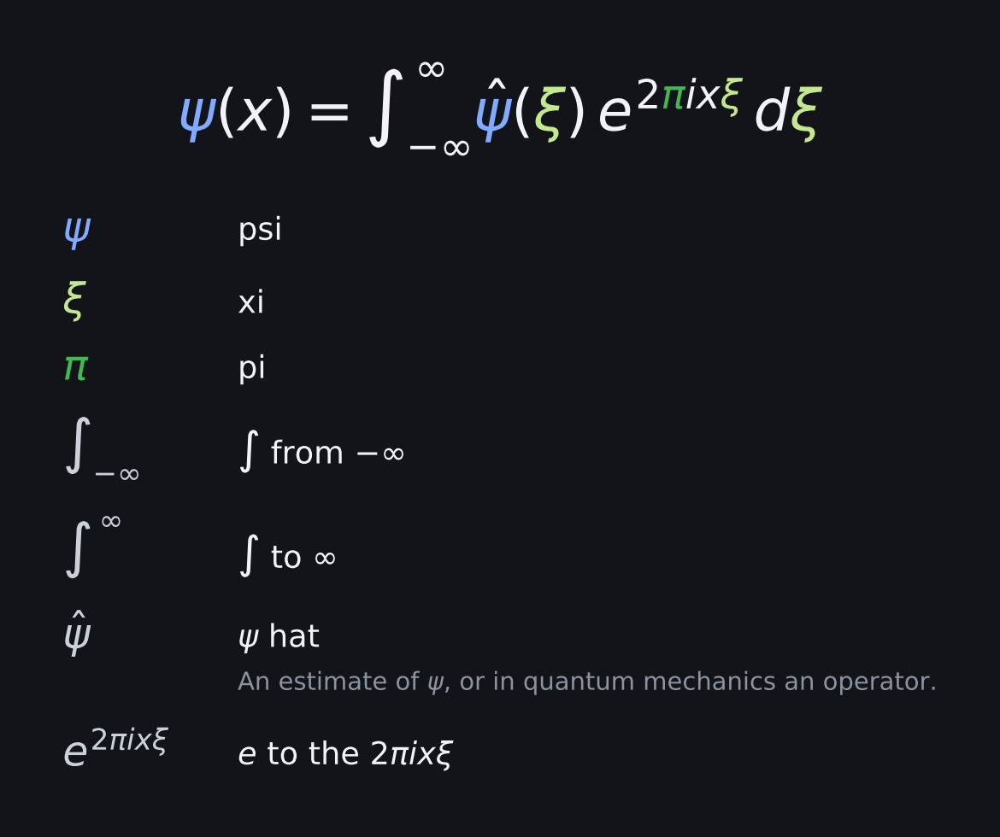
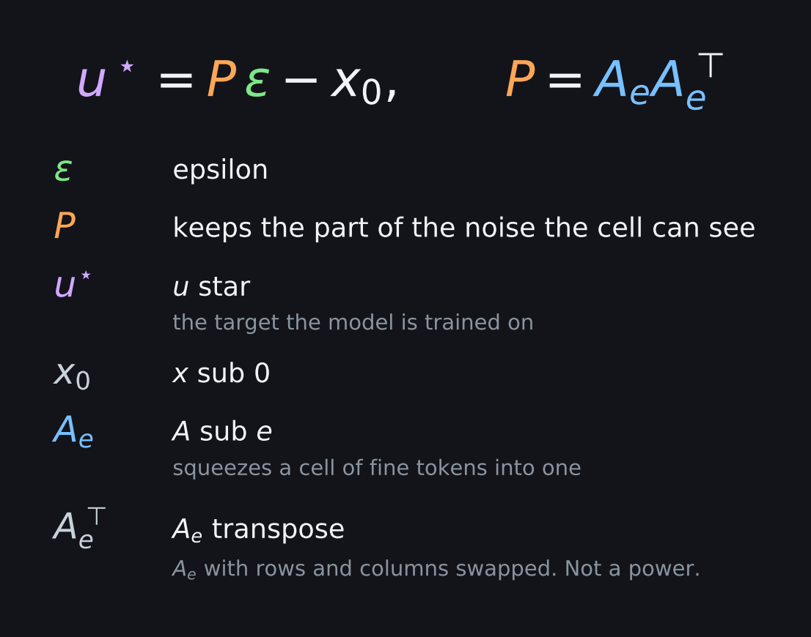

# Usage

Install is on the [README](README.md). If you are an LLM, follow the skill instead of this page: [`.grok/skills/eqlens/SKILL.md`](.grok/skills/eqlens/SKILL.md).

```bash
eqlens 'x=\frac{-b\pm\sqrt{b^{2}-4ac}}{2a}'
eqlens -o formula.svg 'E=mc^2'
eqlens -o formula.png 'E=mc^2'
eqlens 'E=mc^2' > formula.svg
eqlens --format png 'e^{i\pi}+1=0' | imgcat
```

On iTerm2, WezTerm, and Kitty the picture is inline, as a PNG, because a terminal paints pixels. Everywhere else the default is an SVG: a file from `-o`, the text itself through a pipe, or a path to a new file on a terminal that cannot show images. `-o name.png` or `--format png` gives a PNG. The two are the same picture.

<p align="center">
  <br>
  <br>
  
</p>

## Ledger

`--legend` colors each Greek letter in the formula and lists it underneath with its English name in the same color. The same letter keeps the same color every time. Named symbols that are not Greek come next: "h bar", "del", "partial", "expectation". After those, each accent, subscript, and superscript is read aloud once: "ψ hat", "x sub i", "c squared", "∫ from −∞", "∫ to ∞".

A mark that is not arithmetic says what it usually means, once, in a dim line under its name. `u^\star` reads "u star", then "A marked u: often the best one, or its complex conjugate. Not a power." The same goes for transpose, dagger, prime, inverse, hat, bar, tilde, and dot. `A_e^\top` reads "A sub e transpose". A subscript that is already a word, as in `N_{\mathrm{dense}}`, gets no row.

```bash
eqlens --legend '\psi(x)=\int_{-\infty}^{\infty}\hat{\psi}(\xi)\,e^{2\pi i x \xi}\,d\xi'
```

<p align="center">
  
</p>

## What a symbol means here

`--define 'KEY=meaning'` gives a symbol its meaning in this formula. It gets a color and a row. `KEY` is the TeX of the symbol: `P`, `A_e`, `\epsilon`, `u^\star`.

```bash
eqlens --legend \
  --define 'P=keeps the part of the noise the cell can see' \
  --define 'A_e=squeezes a cell of fine tokens into one' \
  --define 'u^\star=the target the model is trained on' \
  'u^\star=P\,\epsilon-x_0,\qquad P=A_eA_e^\top'
```

<p align="center">
  
</p>

## Let Claude say what the parts mean

`--introspect` asks Claude what the symbols and sub-expressions stand for in this formula, and draws them as if you had written the `--define` lines yourself. It also adds one line saying what the formula is.

```bash
python3 -m pip install 'eqlens[ai]'
export ANTHROPIC_API_KEY=...
eqlens --introspect -o einstein.svg 'G_{\mu\nu}+\Lambda g_{\mu\nu}=\frac{8\pi G}{c^4}T_{\mu\nu}'
```

Claude picks the parts worth explaining, such as `G_{\mu\nu}` as a whole and not μ and ν apart. Every part it names is checked against the typeset formula, and one that is not there is dropped. A `--define` of your own wins over Claude's for the same symbol. `--context 'from a paper on video diffusion'` tells it where the formula comes from.

Each call is one request to the Claude API, on your account. To ask once and keep the answer, add `--inspect`: it prints the meanings as JSON and draws nothing. Paste the `define` items into your own `--define` flags or build script, and later runs need no key.

```bash
eqlens --introspect --inspect 'i\hbar\frac{\partial}{\partial t}\Psi=\hat{H}\Psi'
```

`--inspect` alone needs no key and asks nobody. It lists what is in the formula: each symbol, how it is said, and how many times it appears.

The model is `claude-opus-5-5`. Set `EQLENS_MODEL` to use another.

## Hover

Open the SVG in a browser, or put it inline in a page. Point at a symbol: every place it appears lights up with its ledger row, and the rest dims. Point at a ledger row and the formula shows where that symbol is. No script is involved, only CSS inside the SVG.

Inline means the `<svg>` element itself is in the HTML. Inside `` the same file is a still picture, because a browser does not let an image react to the pointer.

```astro
---
import eq from '../eq/target.svg?raw'
---
<figure set:html={eq} />
```

An inline SVG takes its colors from the page when the page sets them:

```css
figure svg { --eq-fg: #1f2328; --eq-bg: #ffffff; --eq-dim: #57606a; --eq-mark: #424a53; }
```

Each SVG scopes its own ids and styles, so many can share a page.

## A few flags

`eqlens --help` lists them.

| Flag | What it does |
| --- | --- |
| `--legend` | Color Greek, and name Greek, accents, subscripts, and superscripts |
| `--brief` | `--legend` without plain subscripts and powers: only the rows with something to say |
| `--tips` | SVG only: also pop up a browser tooltip with the name and meaning. Off by default, since the row that lights up says the same |
| `--introspect` | Ask Claude what the parts mean and draw them. Needs `eqlens[ai]` and an API key |
| `--context 'text'` | With `--introspect`: where the formula comes from |
| `--inspect` | Print what is in the formula as JSON and draw nothing |
| `--define 'KEY=meaning'` | Say what a symbol means here. Repeat for more |
| `--note 'text'` | A short note in fine print under the formula. Repeat for more lines. `$...$` renders as math |
| `-o file` | Write a file, print its absolute path, and do not display it. `.png` writes a PNG, anything else an SVG |
| `--format svg\|png` | Choose the format whatever the file is called |
| `--font sans\|serif\|stix\|cm` | Typeface. `stix` and `cm` look like a printed paper |
| `--local` | Render in this process |
| `--bg '#12141a'` | Background. A bare formula is transparent by default; a card is dark |
| `--color '#f2f2f7'` | Color of everything that has no color of its own |
| `--dpi 220` | PNG resolution |

`eqlensd` is optional. It serves `/svg` and `/png` on `http://127.0.0.1:8765`. When it is running, `eqlens` uses it.

One formula per call. matplotlib mathtext: fractions, roots, integrals, sums, subscripts, superscripts, accents, `\mathrm`, `\mathbb`, `\mathcal`, `\text`, and Greek commands. No `\begin{...}` environments, no preamble, no `\color`, no TikZ. [`tests/equations.py`](tests/equations.py) lists some fifty formulas from physics, quantum physics, and machine learning that are drawn in the tests.

## From Python

```python
from eqlens.render import render_svg, render_png

svg = render_svg(r"e^{i\pi}+1=0", legend=True, define=["e=Euler's number"])
png = render_png(r"e^{i\pi}+1=0", legend=True, dpi=220)

from eqlens.introspect import inspect, introspect

parts = inspect(r"u^\star=P\,\epsilon-x_0")       # no key needed
found = introspect(r"u^\star=P\,\epsilon-x_0")    # asks Claude
svg = render_svg(found["tex"], brief=True, define=found["define"], notes=[found["about"]])
```

## Claude Code

The pane is on the [README](README.md#claude-code). `/eqlens` draws into it. The flags are the same ones in the table above.

## It used to be mathcat

The command was `mathcat` and the server `mathd` before 0.2. Both names still run. `MATHCAT_URL` is still read when `EQLENS_URL` is not set.
